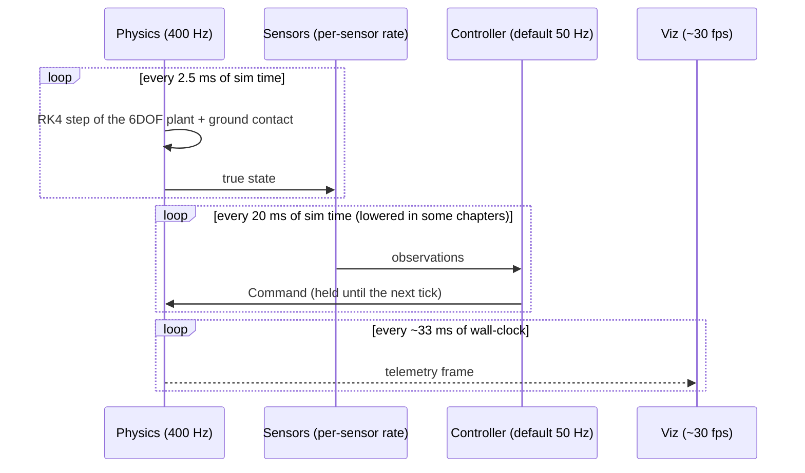
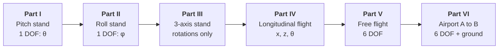
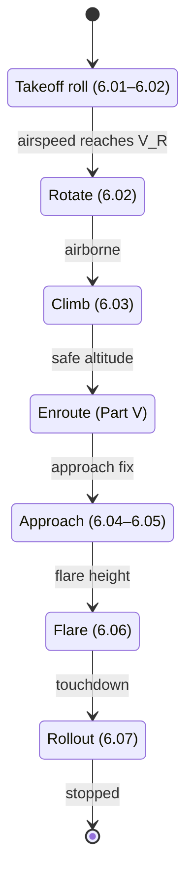
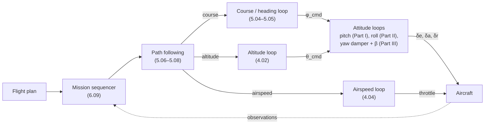

# FlightLab — Harness Design

A progressive flight-control training harness. The student writes one function —
a controller — and the harness supplies the aircraft, the physics, the
visualization, the scenarios, and the grading. Each chapter adds exactly one new
real-world problem the controller must cope with.

The journey starts with an airplane pinned on a wind-tunnel stand that can only
pitch, and ends with a full 6DOF aircraft taking off from one airport, flying a
route, and landing at another.

---

## 1. Goals and non-goals

**Goals**

- **Very gradual difficulty.** One new concept per chapter. A student should
  rarely have to change more than ~20 lines of their controller between chapters.
- **See the physics.** Real-time visualization of the aircraft, its control
  surfaces, and rolling time-history plots, so cause and effect are visible.
- **Real aerospace vocabulary.** The plant is built from standard stability
  derivatives ($`C_{m_\alpha}`$, $`C_{m_q}`$, $`C_{m_{\delta_e}}`$, $`C_{l_p}`$, $`C_{n_\beta}`$, …) so what the student reads in a
  flight-dynamics textbook maps directly to the code and the sim.
- **One plant, many rigs.** A single 6DOF simulation engine is built up front.
  Early chapters *constrain* it (lock degrees of freedom) rather than using a
  separate toy model. Nothing the student learns is invalidated later.
- **Objective feedback.** Every chapter has headless, seeded, repeatable pass
  criteria (settling time, overshoot, tracking error, touchdown sink rate…).
- **Classical control is the path.** P → PD → PID → cascaded loops → guidance.

**Non-goals**

- Not a game or a high-fidelity commercial sim. Flat, non-rotating earth; one
  generic aircraft; simple engine.
- Modern methods (state-space, LQR, Kalman filters, MPC) are **not required** by
  any chapter. The harness is designed so they *can* be used (see §10).

---

## 2. Big picture


<sub>Source: [`docs/diagrams/big-picture.mmd`](docs/diagrams/big-picture.mmd)</sub>

The simulation loop runs several fixed rates on sim time:



Sim time is authoritative. In live runs, the Python side paces the sim against
the wall clock up to the selected playback speed (0.25×, 1×, 4×…) and the
browser only displays it; headless runs go as fast as the CPU allows.

### 2.1 Technology choices

**Everything the student touches is Python**: the controller, the sim, the
grader, and the viz server. **The viz client runs in the web browser.**

- **One language for the student.** He can read the plant he's controlling
  (e.g., `models/aero.py` is the Cm equation from his textbook), set
  breakpoints across the controller/sim boundary, and modify the physics to
  experiment. A compiled sim would be a black box behind a build system. The
  browser client is presentation only: no physics, no control logic, nothing
  that changes a run's result.
- **Speed is adequate.** A numpy 6DOF RK4 step costs about 0.8 ms (measured
  on the M1 pitch rig), so the sim runs about 3× faster than real time:
  plenty for live viewing at 1×, and the viewer says when a faster playback
  speed can't be reached. If headless grading over many seeds gets slow,
  `numba` on the dynamics function can be added later without changing any
  interfaces.
- **Viz in the browser.** `flightlab run` starts a local server and opens the
  viewer in the student's browser (§5.1). This drops the PyQt6 dependency
  (the heaviest install, and the reason WSL needed WSLg), works the same on
  Linux, macOS, Windows and WSL, and gives Parts V–VI a proper 3D renderer
  (three.js) instead of `pyqtgraph.opengl`.
- **No build step for students.** The client is plain HTML, CSS and ES modules
  with vendored libraries (Preact + htm + signals for the UI, uPlot for plots),
  shipped inside the Python package. Students never install Node or run a
  bundler.
- **One viz, not two.** The browser client replaces the earlier pyqtgraph app
  rather than living beside it, so each new view or tool is built once.
- **Setup:** managed with `uv` (`uv sync`, then `uv run flightlab run 1.00`) so
  there's no virtualenv or dependency wrangling for a beginner.

---

## 3. Student-facing interface

### 3.1 The controller

```python
# student/ch01_03.py
from flightlab import ControllerBase, Command

class Controller(ControllerBase):
    def reset(self, info):
        """Called once before each run.
        info: aircraft limits, controller rate, nominal model, chapter metadata."""
        self.integral = 0.0

    def update(self, observations, dt) -> Command:
        """Called at the controller rate. Return surface/throttle commands."""
        err = observations.ref.theta - observations.sensors.theta
        self.log("pitch_err", err)            # appears in live plots + logs
        return Command(elevator=-2.0 * err)
```

- **`observations`** grows chapter by chapter. Fields that don't exist yet in a chapter
  are simply absent, which makes the chapter's scope explicit.
  - `observations.t` — sim time
  - `observations.ref` — what the harness is asking for (θ_cmd, altitude_cmd, flight plan…)
  - `observations.sensors` — what the aircraft can measure (perfect early, noisy later)
  - `observations.truth` — true state; present in early chapters only (see §7)
- **`Command`** fields: `elevator`, `aileron`, `rudder` (radians, surface
  deflection), `throttle` (0–1), `brake` (0–1). Unused fields are ignored by the
  chapter. Commands outside limits are clipped by the actuator model, not
  rejected — saturation is part of the lesson.
- **`self.log(name, value)`** — student telemetry. Any logged signal can be added
  to the live plot panel and is saved with the run. This is the main debugging
  tool and should be encouraged from chapter 1.

### 3.2 One file per chapter

The student keeps a file per chapter (`student/ch01_03.py`, …).
`flightlab new 1.04` copies the previous chapter's file as the starting point.
This keeps a history of their progress, makes regressions easy to diagnose, and
lets them compare old vs new controllers on the same scenario. From Part II on,
they're encouraged to factor reusable pieces (their own `PID` class, filters)
into `student/lib/`.

### 3.3 CLI

```
flightlab list                      # chapters, status (passed / not yet)
flightlab guide 1.03                # print the chapter's guide
flightlab run 1.03                  # live viz with student controller
flightlab run 1.03 --manual         # fly it yourself (sliders / keyboard)
flightlab run 1.03 --open-loop      # no controller, surfaces neutral (finding trim is 1.01's job)
flightlab grade 1.03                # headless, N seeded scenarios → report
flightlab replay runs/<run-id>      # replay a saved run in the viz
flightlab compare runs/<a> runs/<b> # overlay two runs' plots (planned, M2)
flightlab new 1.04                  # start next chapter from your 1.03 file
```

---

## 4. Plant (the simulation)

### 4.1 Conventions (documented loudly — students trip on these)

- World frame: **NED** (north-east-down), flat, non-rotating earth.
- Body frame: **FRD** (x forward, y right wing, z down), origin at the CG.
- Angles: radians internally; the viz and plots can show degrees.
- Attitude state: quaternion (no gimbal lock); Euler angles (φ, θ, ψ) are
  provided in `observations`.
- Surface sign conventions (standard): positive elevator = trailing edge down =
  nose-down moment ($`C_{m_{\delta_e}} < 0`$); positive aileron = right roll; positive rudder =
  trailing edge left = nose-left ($`C_{n_{\delta_r}} < 0`$).

### 4.2 State vector

```math
x = \big[\;
\underbrace{p_N,\, p_E,\, p_D}_{\text{position (m, NED)}},\;
\underbrace{u,\, v,\, w}_{\text{body velocity (m/s)}},\;
\underbrace{q_0,\, q_1,\, q_2,\, q_3}_{\text{attitude quaternion}},\;
\underbrace{p,\, q,\, r}_{\text{body rates (rad/s)}},\;
\underbrace{\delta_e,\, \delta_a,\, \delta_r}_{\text{actual surfaces}},\;
\underbrace{n}_{\text{engine}},\;
\underbrace{m_{fuel}}_{\text{kg}}
\;\big]^T
```

Note the two different q's: $`q`$ is pitch rate, while $`q_0 \ldots q_3`$ are
quaternion components (and $`\bar{q}`$ is dynamic pressure). In code these are
`q`, `quat`, and `qbar` to avoid confusion.

The order is fixed and documented, and exposed as named indices
(`flightlab.state.IDX.q`), so a student can build models against it later.

### 4.3 Dynamics core

- Standard rigid-body 6DOF equations (forces and moments in body axes),
  integrated with fixed-step RK4 at 400 Hz.
- Implemented as a **pure function** with no hidden state:

  ```math
  \dot{x} = f(x,\, u,\, \text{params},\, \text{env})
  ```

  Everything with memory (actuators, engine lag, fuel, sensor delay
  buffers) lives in explicit state. This is required for rigs, trimming,
  linearization, and replay (§10).
- Ground contact is computed inside `f` as a force/moment contribution (§4.8).

### 4.4 Rigs (DOF constraints)

Early chapters use a virtual **test rig** that locks degrees of freedom. The
same `f` is evaluated; the rig then zeros the derivatives of locked states and
prescribes the air-relative velocity.

| Rig | Free states | Air-relative velocity | Used in |
|---|---|---|---|
| `pitch_gimbal` | θ, q | prescribed (tunnel airspeed + gusts) | Part I |
| `roll_gimbal` | φ, p | prescribed | Part II |
| `attitude_gimbal` | φ, θ, ψ, p, q, r | prescribed | Part III |
| `heave_pitch` | θ, q, altitude, vertical speed (forward speed held) | from motion + wind | Part IV (start) |
| `longitudinal` | x, z, u, w, θ, q | from motion + wind | Part IV |
| `free` | everything | from motion + wind | Parts V–VI |

The gimbal pivot is always at the CG (gravity produces no torque on the rig).
When the CG moves in later chapters, it moves *relative to the aerodynamic
center*, which is what changes stability.

### 4.5 Aircraft

A generic high-wing light trainer with tricycle gear (≈1000 kg, stall ≈ 25 m/s,
cruise ≈ 55 m/s), with parameters derived from public textbook data. Recommended
references (the student should use one of these as a companion text):

- Beard & McLain, *Small Unmanned Aircraft: Theory and Practice* — builds the
  same 6DOF model chapter by chapter, with an autopilot design that closely
  matches this harness's progression.
- Stevens, Lewis & Johnson, *Aircraft Control and Simulation*.
- Roskam, *Airplane Flight Dynamics and Automatic Flight Controls*.

Parameters live in `aircraft/trainer.yaml`: geometry (S, b, c̄), mass and
inertia (dry), fuel tank location and capacity, aero derivatives, actuator
limits, engine data, gear geometry.

### 4.6 Aerodynamics

Coefficient build-up in stability/body axes:

```math
\begin{aligned}
C_L &= C_{L_0} + C_{L_\alpha}\,\alpha + C_{L_q}\,\frac{q\bar{c}}{2V} + C_{L_{\delta_e}}\,\delta_e \\
C_D &= C_{D_0} + K\,C_L^2 \qquad \text{(drag polar)} \\
C_m &= C_{m_0} + C_{m_\alpha}\,\alpha + C_{m_q}\,\frac{q\bar{c}}{2V} + C_{m_{\delta_e}}\,\delta_e \\
C_Y &= C_{Y_\beta}\,\beta + C_{Y_p}\,\frac{pb}{2V} + C_{Y_r}\,\frac{rb}{2V} + C_{Y_{\delta_r}}\,\delta_r \\
C_l &= C_{l_\beta}\,\beta + C_{l_p}\,\frac{pb}{2V} + C_{l_r}\,\frac{rb}{2V} + C_{l_{\delta_a}}\,\delta_a + C_{l_{\delta_r}}\,\delta_r \\
C_n &= C_{n_\beta}\,\beta + C_{n_p}\,\frac{pb}{2V} + C_{n_r}\,\frac{rb}{2V} + C_{n_{\delta_a}}\,\delta_a + C_{n_{\delta_r}}\,\delta_r
\end{aligned}
```

Coefficients become forces and moments through dynamic pressure
$`\bar{q} = \tfrac{1}{2}\rho V^2`$:

```math
L = \bar{q} S C_L, \quad D = \bar{q} S C_D, \quad Y = \bar{q} S C_Y, \qquad
\mathcal{L} = \bar{q} S b\, C_l, \quad M = \bar{q} S \bar{c}\, C_m, \quad N = \bar{q} S b\, C_n
```

On the `pitch_gimbal` rig (Part I) the whole plant reduces to one equation,
which is the first thing the student will read in the code:

```math
I_{yy}\,\dot{q} = \bar{q}\,S\,\bar{c}\left(C_{m_0} + C_{m_\alpha}\,\alpha + C_{m_q}\,\frac{q\bar{c}}{2V} + C_{m_{\delta_e}}\,\delta_e\right), \qquad \dot{\theta} = q
```

- **CG effect:** moments are computed about the aerodynamic reference point and
  transferred to the actual CG, so moving the CG changes the effective
  $`C_{m_\alpha}`$ (static margin) physically, not by editing a number.
- **Stall:** smooth sigmoid blending between linear and flat-plate models
  (Beard & McLain style). Off by default until it's a chapter topic; smooth so
  the model stays differentiable.
- **Ground effect:** simple CL increase / induced-drag reduction below one
  wingspan. Enabled in the landing chapters.

### 4.7 Propulsion, mass, atmosphere

- **Engine/propeller:** first-order spool lag on engine state $`n`$ toward the
  throttle command $`\delta_t`$, and a simple thrust model:

  ```math
  T = T_{max}(\rho)\, n \left(1 - \frac{V}{V_{max}}\right), \qquad \dot{n} = \frac{\delta_t - n}{\tau_{eng}}
  ```

  Thrust line can be offset from the CG (pitch-with-power coupling),
  enabled when power is introduced. P-factor and torque are optional extras.
- **Fuel:** flow ∝ throttle. CG and inertia are recomputed from dry mass + tank
  contents every step.
- **Atmosphere:** ISA density vs altitude. Constant in the gimbal chapters.

### 4.8 Ground and airports

- Three gear contact points (nose + two mains), each a spring-damper normal force
  with rolling friction, brakes on the mains, and nosewheel steering linked to
  rudder.
- Runways: a heading, threshold position, length (≈1200 m), width (30 m), and
  elevation. Airport B is ~15 km from airport A and at a different elevation.
- **Failure detection:** hard landing (sink rate limit), tail strike, nose-gear
  first, wingtip strike, departing the runway, overspeed, stall below a safe
  altitude. A failure ends the run with a clear message in the viz.

### 4.9 Environment / disturbances (all switchable by chapter config)

- Steady wind vector (any direction, can vary with altitude for shear).
- Discrete gusts: step and "1 − cosine" shapes, vertical/longitudinal/lateral.
- Continuous turbulence: Dryden model, intensity levels (light/moderate).
- Tunnel airspeed profile (gimbal rigs): constant, steps, slow sinusoid.
- Live air-vector override (stand rigs only, see §5.4): an offset the student
  sets from the viz, added on top of the scenario's scripted air vector.
- Parameter uncertainty: truth model parameters randomly perturbed (e.g., ±10%
  on derivatives) per seeded scenario, so tuning against one run isn't enough.

### 4.10 Actuators

Per surface: position limits, rate limit, first-order lag (servo bandwidth), and
optional deadband/backlash. Each is turned on in its own chapter. The viz always
shows **commanded vs actual** deflection.

### 4.11 Sensors

Three levels, selected by chapter:

1. **Truth:** perfect state.
2. **Navigation solution (default for most of the course):** what an
   autopilot's AHRS/INS + air-data computer would output: attitude, rates,
   airspeed, altitude, vertical speed, position, ground speed, track — each with
   configurable noise, bias, sample rate, and latency.
3. **Raw sensors (optional, for the curious):** accelerometers, gyros,
   magnetometer, GPS, barometer, pitot. Never required by a chapter; supports
   writing your own estimator (§10).

Noise and bias statistics are published in `info.sensors` (not hidden).

---

## 5. Visualization

A **browser client** served by the Python process that runs the sim. Python owns
the simulation and its clock; the browser draws what it is sent and sends back
what the student does. The same client serves live runs and replays.

### 5.1 Architecture


<sub>Source: [`docs/diagrams/viz-server.mmd`](docs/diagrams/viz-server.mmd)</sub>

#### Process model

- `flightlab run 1.03` (and `replay`) starts one Python process. It serves the
  viewer on `127.0.0.1` on a free port, prints the URL, and opens it with
  `webbrowser`. If no browser opens (common on WSL, or on a headless machine),
  the student clicks the printed URL. **Ctrl+C** in the terminal ends the run
  and saves the log for `flightlab replay latest`. Closing the tab doesn't stop
  anything, and a reload reconnects.
- **Other devices.** `--host <address>` serves on another interface, e.g. the
  machine's Tailscale IP, to watch from a tablet; `--port` fixes the port so
  the address stays the same between runs. The default stays localhost-only.
- **Sim thread** (`viz/runner.py`). Wakes at 60 Hz, applies queued inputs, and
  advances the sim by `elapsed wall time × speed` unless paused. Pause,
  single-step (one controller period), playback speed and reset are Python
  state, not client state.
  - The sim moves in whole 2.5 ms physics steps, so each tick lands up to one
    step past its target. The next tick aims from the *intended* sim time,
    not from where the sim landed, so 1× stays at real time instead of
    drifting fast.
  - It measures the speed it actually achieves. If the sim can't keep up with
    the selected speed, the status bar says so.
- **Server thread** (`viz/server.py`). An asyncio event loop running the
  `websockets` library. It serves the static client files over HTTP and the
  WebSocket at `/ws` on the same port. About 30 times a second it sends each
  connected browser the log rows recorded since that browser's last frame.
- **Locking.** The server reads the log under a lock. The sim thread holds it
  for slices of at most ~8 ms of physics steps and then yields, so a reader
  always gets a turn even when the sim is running flat out. (Locking every
  single step starved the reader down to ~2 frames/s.)
- **Breakpoints.** If the student stops at a breakpoint in their controller,
  only the sim thread blocks. The server keeps sending frames, marked *busy*
  after 0.5 s, and the page shows "Waiting for your code" instead of
  disconnecting.
- **Inputs go through a queue.** The server never calls into `Simulation`
  directly. Inputs are queued and the sim thread applies them between physics
  steps, then logs them as timestamped events (§5.5). Every input lands at a
  definite sim time, so replays stay exact.
- **Errors.** A `ControllerError` or `SimulationError` pauses the run. The
  browser shows the message and the student's traceback, which is also printed
  in the terminal. Play is disabled until Reset.

#### Protocol

JSON messages over one WebSocket, each with a `type` field. Rows arrive at
the 100 Hz log rate with a few dozen channels, about 40 KiB/s at 1×, so JSON
is fine. Binary `Float64Array` frames are an optimization to add only if a
later Part needs it. NaN values are sent as `null`.

**Server → browser**

| `type` | When | Contents |
|---|---|---|
| `hello` | on connect | protocol version, chapter (id, title, rig, duration), mode (`controller` / `manual` / `open_loop` / `replay`), `live`, controller period, tunnel defaults and slider ranges, manual elevator range; for replays, the run's duration |
| `frame` | ~30 Hz | `state`: sim time, run state (`running` / `paused` / `finished` / `error`), selected and achieved speed, `busy`, reset `generation`, the error (message + student traceback) if any, and, for live runs, manual mode, manual elevator and the wind tunnel target. `rows`: new log rows in columnar form (`{"t": [...], "theta": [...], "log.error_deg": [...]}`), without the raw `x.*` state-vector channels. `reset: true` means "clear and start over" |

A browser that connects (or reconnects, or connects after a reset) gets a
`reset` frame with the last 30 s of log first. Student `self.log()` channels
are just more `log.*` columns, so the signal picker finds new ones as they
appear. On connect and after a reset the browser takes its control values
(manual mode, elevator, air target) from `state`. Otherwise its controls stay
authoritative.

**Browser → server**

| `type` | Fields | Maps to |
|---|---|---|
| `pause` / `resume` / `step` | — | sim-thread clock (`step` pauses, then advances one controller period) |
| `speed` | `value` (0.05–16) | playback speed |
| `reset` | — | saves the run so far, then `Simulation.reset()`; manual mode and elevator carry over |
| `kick` | `sign` | `Simulation.kick()` |
| `set_air` | `airspeed` (m/s), `flow_angle` (rad), `smooth` | `Simulation.set_air()` |
| `reset_air` | `smooth` | `Simulation.reset_air()` |
| `manual` | `enabled` | `Simulation.set_manual()` |
| `elevator` | `value` (rad) | `Simulation.set_manual_elevator()` |

Malformed or unknown messages are ignored. In replay mode only the clock
messages (pause, resume, step, speed, reset) apply. Planned with later
milestones: `seek` for replays, `overlay` (a previous run's traces faded
behind the live ones, §5.4), and new inputs per Part (`gust`, `aileron`,
`rudder`, `throttle`, lateral flow) alongside the `Simulation` methods they
call.

**Security.** By default the server listens on localhost only. The URL
carries a random per-run token that the WebSocket handshake must present
(compared in constant time). Any web page can try to open a WebSocket to
localhost, so without the token another site could drive the student's run.
Static files need no token, since they're the same for everyone. With
`--host`, anyone who can reach that address can load the page, but only
someone with the printed link can connect to the run.

#### Client

- **No build step.** `flightlab/viz/web/` holds `index.html`, `app.css` and
  ES modules loaded directly by the browser. An import map in `index.html`
  maps bare names (`preact`, `uplot`, …) to vendored single files in
  `web/vendor/`, whose `README.md` lists each library's version, source file
  and license. They're shipped as package data. Nothing is fetched from a CDN,
  so the viewer works offline. Updating a library means replacing one file;
  nobody needs Node.
- **UI framework:** [Preact](https://preactjs.com) with
  [htm](https://github.com/developit/htm) (tagged templates instead of JSX, so
  no compiler) and [@preact/signals](https://github.com/preactjs/signals).
  Preact renders the layout and every control. Signals hold connection,
  run state, control values and the signal list, so a change re-renders only
  what reads it. About 25 KB in all.
- **Drawing stays outside Preact.** The side view and the plots are plain
  classes that Preact mounts once. A `requestAnimationFrame` loop redraws them
  from the telemetry store (`js/store.js`, the last 60 s of rows) only when a
  new frame has arrived. This keeps 30 fps cheap, and it's the pattern the
  three.js view will use too.
- **Plots:** [uPlot](https://github.com/leeoniya/uPlot), rolling 20 s window.
  Flat traces get at least a ±1 y-range, instead of uPlot's default 0–100.
- **Aircraft views:** SVG. The side view (`js/side_view.js`) draws in world
  meters inside a `scale(1,-1)` group, so the geometry and rotation signs match
  the physics (x forward, y up, positive rotation = nose up). The air arrow's
  handle is dragged with pointer events, so it works with a mouse or touch.
  three.js comes in for the optional 3D chase view (M6).
- **Keyboard:** ↑/↓ move the elevator by 0.5° and switch to manual, Space
  centers it, P pauses.
- **Files:** `main.js` (signals, components, render loop), `connection.js`
  (WebSocket with reconnect), `store.js`, `side_view.js`, `plots.js`,
  `theme.js` (shared colors).
- **Screenshots for chapter guides:** the hidden `--screenshot PATH --until T
  [--kick-at T]` options advance the sim headless, then capture the page with
  Playwright's headless Chromium. Playwright is in the optional `browser`
  extra, so students don't install it.

### 5.2 Layout

```
┌──────────────────────────────┬───────────────────────────────┐
│                              │  θ, θ_cmd           (rolling) │
│   Aircraft view(s)           ├───────────────────────────────┤
│   (depends on Part)          │  α, q                         │
│                              ├───────────────────────────────┤
│                              │  δe_cmd, δe_actual            │
├──────────────────────────────┼───────────────────────────────┤
│ ▶ ❚❚ ⏭ step  speed 1×  reset │  student self.log() signals   │
│ [kick] [gust] [manual] [air] │  (selectable)                 │
└──────────────────────────────┴───────────────────────────────┘
```

### 5.3 Views by Part

| Part | Aircraft views |
|---|---|
| I (pitch rig) | Side view on stand: wind arrows (length ∝ airspeed, tilt = gust), velocity vector, α arc, elevator drawn with optional ×3 exaggeration |
| II (roll rig) | Rear view: bank angle, aileron deflection |
| III (attitude rig) | Side + rear + top views, attitude indicator |
| IV (longitudinal) | Scrolling side view with terrain line, altitude and speed tapes |
| V–VI (free) | Top-down map (route, runways, ground track), vertical profile (altitude vs distance, glidepath), primary flight display, optional 3D chase camera (three.js) |

### 5.4 Interactive tools

- **Pause / single-step / playback speed.**
- **Kick:** applies a moment impulse about the free axis. This is the quickest
  way to *feel* stability, damping, and disturbance rejection.
- **Gust button:** fires a discrete gust on demand.
- **Manual mode:** slider/keyboard control of the surfaces, so the student can
  try flying it by hand before automating it. Doing this at the start of a Part
  is part of the chapter guide.
- **Overlay reference run** (planned, M2): show a previous run's traces faded
  behind the live ones.

#### Wind tunnel panel (stand chapters, Parts I–III)

While the aircraft is on a stand, the student can change the air flowing over it
in real time and watch their controller respond.

- **Controls:**
  - **Airspeed** slider (e.g., 15–70 m/s). Changes dynamic pressure, so control
    power and stiffness change with it.
  - **Vertical flow angle** (up/down-flow, e.g., ±15°). Changes α without
    changing θ, which is exactly what a vertical gust does.
  - **Lateral flow angle** (Part II–III, e.g., ±15°). Creates sideslip β, which
    rolls the aircraft through dihedral effect ($`C_{l_\beta}`$) and yaws it
    through weathercock stability ($`C_{n_\beta}`$).
  - **Turbulence** intensity slider (off / light / moderate).
  - **Reset air** returns to the chapter's scripted air vector.
- **Direct manipulation:** the air arrows in the side (and, from Part III,
  top/rear) views can be dragged. Arrow length = airspeed, tilt = flow angle.
- **Step vs smooth:** a toggle chooses whether changes apply instantly (a step,
  like a sharp-edged gust) or ramp in over about a second.
- **Cause and effect in the plots:** airspeed and flow angles get their own
  plot traces, so the student sees "I tilted the air" on the same time axis as
  "α jumped, θ dipped, the elevator moved, θ recovered".
- **Available from chapter 1.00**, ahead of the gust and airspeed chapters. It
  makes the "Observe first" step hands-on: before 1.12, the student can tilt
  the air and *see* their PID fail to reject it. Chapter guides list specific
  experiments under "Things to try".
- **What the controller sees:** the air vector is a disturbance, not an
  observation. The controller only learns about it through its effect on the
  aircraft, plus airspeed once the airspeed sensor arrives (1.14), just like a
  real aircraft.
- **Free-flight chapters** (Parts IV–VI) keep the gust button but not this
  panel; there, wind comes from the scenario.

### 5.5 Logging and replay

Every graded run, and every live run when it ends (Ctrl+C) or is reset after
more than 1 s, writes `runs/<timestamp>_<chapter>_<label>/` with full state, commands,
sensors, student telemetry (`.npz`/CSV), the resolved config, and the seed.
Interactive inputs (wind tunnel panel, kicks, gust button, manual surface
commands) are logged as timestamped events, so a replay reproduces the run
exactly. Runs with interactive inputs are marked *sandbox*; grading always
uses the scripted, headless scenarios.
Replay uses the same browser client, fed from the saved log instead of a live sim. Logs can also be loaded in a notebook for analysis.

---

## 6. Chapters

Each chapter is a folder:

```
chapters/1.03_integral/
  chapter.yaml     # rig, enabled effects, observations fields, scenarios, pass criteria
  GUIDE.md         # concept, physics you need, your task, things to try, questions
```

`GUIDE.md` structure, every chapter:
1. **What's new** — the one thing that changed, and why real aircraft have it.
2. **Physics you need** — short, with textbook pointers.
3. **Observe first** — run your previous controller on this chapter and describe
   what goes wrong (this is the hook for every chapter).
4. **Your task** — what to implement.
5. **Pass criteria** — the numbers the grader checks.
6. **Things to try** — experiments (kick it, change a gain ×2, turn the effect off).
7. **Questions** — short conceptual questions to answer in a notes file.

Pass criteria below are indicative; exact thresholds are set by running the
instructor reference solutions (§9).

The six Parts, and how the aircraft is freed up along the way:



### Part I — Pitch on a gimbal (1DOF: θ)

Wind-tunnel stand, constant airspeed, pivot at the CG. Only the elevator matters.

| # | New concept | Student does | Graded on |
|---|---|---|---|
| 1.00 | Meet the harness | Run open loop; fly by hand in manual mode; kick it | — (orientation) |
| 1.01 | Trim | Return a constant elevator that holds θ = 0 (found by experiment) | \|θ\| < 0.5° after 10 s |
| 1.02 | Proportional control | $`\delta_e = -K_p(\theta_{cmd} - \theta)`$; observe steady-state error from $`C_{m_0}`$ and oscillation at high gain | θ within 2° of command |
| 1.03 | Derivative / damping | Add rate feedback using q; see overshoot vanish | Overshoot < 10%, settling < 3 s |
| 1.04 | Integral action | PID; steady-state error removed | Steady-state error < 0.2° |
| 1.05 | Step and ramp tracking | Command schedule of steps and ramps; tune for a trade-off | RMS tracking error, control effort |
| 1.06 | Surface limits | Saturation causes integrator windup; implement anti-windup | Recovery from large step without overshoot blowup |
| 1.07 | Rate limits | Elevator can't move instantly; retune | Same as 1.05 under rate limit |
| 1.08 | Servo lag | First-order actuator lag; see phase loss cause oscillation | Stability margin proxy (no sustained oscillation) |
| 1.09 | Discrete time | Controller rate drops to 20 Hz, one-step compute delay | Same as 1.05 at 20 Hz |
| 1.10 | Sensor noise | Noisy θ and q; raw derivative chatters; filter it | Elevator activity (RMS δe rate) below limit |
| 1.11 | Sensor bias | Constant bias on θ; understand what integral can't fix | Explain + pass with bias-aware design |
| 1.12 | Vertical gusts | α ≠ θ for the first time; discrete gusts | Peak θ deviation per gust |
| 1.13 | Turbulence | Continuous Dryden turbulence | RMS θ error |
| 1.14 | Airspeed changes | Tunnel speed varies; control power $`\propto \bar{q}`$; gain scheduling | Consistent response across speeds |
| 1.15 | CG location | CG moves aft toward neutral point; less stable airframe | Pass at 3 CG positions |
| 1.16 | Relaxed stability | CG aft of neutral point; open-loop unstable | Stable at unstable CG (the "fly-by-wire" chapter) |
| 1.17 | Fuel burn | CG and inertia drift during the run | Pass over full fuel range |
| 1.18 | Part I capstone | Everything on, randomized seeds, parameter uncertainty | Pass N of N seeded scenarios |

### Part II — Roll on a gimbal (1DOF: φ)

Short Part: the student reuses their PID class on a new axis. Shows how
transferable the skills are, and introduces their `student/lib/`.

| # | New concept | Student does | Graded on |
|---|---|---|---|
| 2.01 | Roll dynamics | Open loop: roll damping ($`C_{l_p}`$) makes roll rate settle, not angle | — |
| 2.02 | Roll rate control | Aileron → p loop | p tracking |
| 2.03 | Bank angle hold | Outer φ loop around inner p loop — **first cascade** | φ steps, settling |
| 2.04 | Roll with realism | Limits, lag, noise, gusts on together | Part II capstone |

### Part III — Attitude on a 3-axis gimbal (rotations only)

| # | New concept | Student does | Graded on |
|---|---|---|---|
| 3.01 | Three axes at once | Run Part I + II controllers together; yaw is free | — |
| 3.02 | Euler angles and coupling | See how roll changes pitch/yaw rates; φ/θ/ψ vs p/q/r | Hold attitude with cross-axis kicks |
| 3.03 | Adverse yaw | Aileron causes yaw; add aileron→rudder interconnect | Sideslip during roll |
| 3.04 | Dutch roll and yaw damper | Lightly damped yaw/roll oscillation; washout yaw damper | Dutch roll damped within 2 cycles |
| 3.05 | Sideslip hold | Rudder holds β = 0 under lateral gusts | Peak β |
| 3.06 | Attitude capstone | All three axes, disturbances, noise | Pass N seeded scenarios |

### Part IV — Longitudinal flight (released from the stand)

| # | New concept | Student does | Graded on |
|---|---|---|---|
| 4.01 | Heave + pitch rig | Forward speed held; aircraft can rise/fall. Lift ≠ weight → climbs/sinks | — |
| 4.02 | Altitude hold | Cascade: altitude → θ_cmd → their pitch controller | Altitude steps |
| 4.03 | Free longitudinal, open loop | Speed is free: see the **phugoid** (slow speed/altitude exchange) and short period | — |
| 4.04 | Throttle and airspeed | Throttle → airspeed loop | Airspeed steps |
| 4.05 | Coupling | Elevator changes speed, throttle changes altitude; thrust-line offset | Altitude + speed held together |
| 4.06 | Climbs and descents | Track commanded flight-path angle / vertical speed | Profile tracking |
| 4.07 | Stall awareness | Stall model on; protect against low speed / high α | No stall during profile |
| 4.08 | Altitude-varying air | Density changes with altitude; revisit scheduling | Profile at two altitudes |
| 4.09 | Longitudinal capstone | Wind, turbulence, noise, fuel burn | Pass N seeded scenarios |

### Part V — Full 6DOF flight

| # | New concept | Student does | Graded on |
|---|---|---|---|
| 5.01 | Free flight, open loop | Spiral and Dutch roll modes in free flight | — |
| 5.02 | Wings level + altitude/speed hold | Combine Parts III and IV | Hold for 2 min with gusts |
| 5.03 | Coordinated turns | Bank to turn; rudder keeps β ≈ 0; elevator holds altitude in turn | Altitude loss and β in turns |
| 5.04 | Heading hold | Cascade: heading → φ_cmd → bank controller | Heading steps |
| 5.05 | Wind and course | Heading ≠ ground track; track course over ground | Course error in crosswind |
| 5.06 | Straight-line path following | Follow a line between two points (cross-track error) | Cross-track RMS |
| 5.07 | Waypoint navigation | Sequence through a list of waypoints; turn anticipation | Route completion, cross-track |
| 5.08 | 3D path following | Follow waypoints with altitude and speed schedule | 3D tracking error |
| 5.09 | 6DOF capstone | Full route in the air with wind, turbulence, noise | Pass N seeded scenarios |

### Part VI — Airport to airport

The harness supplies a **flight plan**: departure runway, a simple ideal route
(departure leg → cruise waypoints → approach fix → final approach), target
altitudes and speeds per leg, and the arrival runway. Early on, a built-in
**mission sequencer** handles phase changes and gives the student's autopilot
commands; by the end the student writes the sequencer.

Mission phases (the sequencer's state machine):



| # | New concept | Student does | Graded on |
|---|---|---|---|
| 6.01 | On the ground | Gear model; hold runway centerline with rudder/nosewheel at low speed | Centerline deviation |
| 6.02 | Takeoff roll and rotation | Full throttle, track centerline, rotate at V_R, hold pitch attitude | No tail strike, liftoff in runway |
| 6.03 | Initial climb | Climb at V_Y to a safe altitude, then hand off to the Part V autopilot | Climb speed tracking |
| 6.04 | Approach: lateral | Intercept and track the extended runway centerline | Lateral error at 1 km out |
| 6.05 | Approach: vertical | Track a 3° glidepath with speed control | Glidepath error |
| 6.06 | Flare and touchdown | Ground effect on; arrest sink rate; touch down mains first in the zone | Sink rate, touchdown point, attitude |
| 6.07 | Rollout | Brakes, centerline tracking, stop on runway | Stop distance, centerline |
| 6.08 | Crosswind landing | Crab on approach, de-crab/slip before touchdown | Side load at touchdown |
| 6.09 | Mission sequencer | Student writes the phase state machine (takeoff → … → stop) | Full mission, calm air |
| 6.10 | Final exam | A → B with wind, shear, turbulence, sensor noise, fuel burn, parameter uncertainty | Pass N of N seeded missions |

---

### How the controller grows

By the end, the student's controller is a stack of nested loops. Each was built
in an earlier chapter and is never thrown away: outer loops just command the
inner ones.



## 7. Observation policy by Part

| Part | `observations.truth` | `observations.sensors` level | `observations.ref` |
|---|---|---|---|
| I (1.00–1.09) | yes | truth | θ_cmd |
| I (1.10+) | no | nav solution (noisy) | θ_cmd |
| II–III | no | nav solution | φ_cmd, θ_cmd, β_cmd |
| IV | no | nav solution | altitude, airspeed, γ commands |
| V | no | nav solution | heading / course / waypoints |
| VI | no | nav solution | flight plan (+ sequencer commands until 6.09) |

Raw sensors are available as an opt-in from Part III on, but never required.
Truth is always in the logs for grading and post-run analysis.

---

## 8. Grading

- `chapter.yaml` defines scenarios (initial conditions, references, disturbances)
  and metrics with thresholds.
- `flightlab grade` runs each scenario headless across N seeds and prints a
  report: per-metric value vs threshold, pass/fail, and a link to the run logs.
- Standard metric library: rise/settling time, overshoot, steady-state error,
  RMS tracking error, peak deviation, control effort / surface activity, mode
  damping estimate, touchdown sink rate, touchdown position, cross-track error,
  mission completion.
- Grades are local and informational. Progress is stored in `progress.json`.

---

## 9. Repository layout

```
flightlab/
  core/          state.py, dynamics.py (pure f), integrator.py, rigs.py
  models/        aero.py, propulsion.py, mass.py, atmosphere.py, ground.py,
                 actuators.py, sensors.py, wind.py (gusts, Dryden)
  scenario/      config loading, references, flight plan, mission sequencer
  analysis/      trim.py, linearize.py, metrics.py
  viz/           app.py (show: start runner + server, open browser, screenshots),
                 runner.py (sim thread, clock, input queue), server.py (HTTP +
                 WebSocket, token), sources.py (live / replay)
    web/         index.html (import map), app.css, js/ (main, connection, store,
                 side_view, plots, theme; later rear, top, map, profile, pfd,
                 chase3d), vendor/ (Preact, htm, signals, uPlot; three.js in M6)
  cli.py
aircraft/trainer.yaml
chapters/<n.nn_name>/{chapter.yaml, GUIDE.md}
student/         chNN_MM.py files, lib/, notes.md
solutions/       instructor reference controllers (kept separate from the student)
tests/           physics sanity tests, chapter solvability tests
runs/            run logs (gitignored)
```

**Dependencies:** Python 3.11+, numpy, scipy, PyYAML, websockets, and a
current web browser (import maps: Chrome/Edge 89+, Firefox 108+, Safari 16.4+).
Vendored client libraries: Preact, htm, @preact/signals, uPlot, three.js (M6).
Extras: `dev` (pytest), `browser` (Playwright, for guide screenshots and the
browser smoke test; then `playwright install chromium`).
Optional: python-control (Bode/root-locus for the curious), numba (speed).

**Harness verification:**
- Viz tests (`tests/test_viewer.py`): static files are served and can't
  escape `web/`; the WebSocket rejects a wrong token; headless protocol checks
  (hello, frames, inputs logged as events, pause/step timing, reset, malformed
  messages ignored); a controller error pauses the run and blocks resume. A
  Playwright smoke test (skipped without Chromium) opens the page, clicks Kick,
  flies with ↑, drags the air arrow and pauses, then checks those inputs
  reached the sim log with no browser console errors.
- Physics tests: energy and momentum sanity checks, trim matches the textbook
  aircraft's published values, open-loop modes (short period, phugoid, Dutch
  roll, roll, spiral) have the expected frequencies and damping.
- Every chapter has an instructor reference solution in `solutions/` that must
  pass `grade`, and the previous chapter's solution must visibly fail or degrade
  on the new chapter. That confirms each chapter actually teaches its one new
  thing.

---

## 10. Support for modern methods (optional, not required)

Modern methods are not part of the curriculum, but a student should be able to
write an LQR, Kalman filter, or MPC in their `controller.py` at any point. **No
changes to the final plant are needed later**, *as long as* the following are
designed in from the start. They're cheap now and painful to retrofit:

1. **Pure dynamics function.** $`\dot{x} = f(x, u, \text{params}, \text{env})`$ with all memory in
   explicit state (§4.3). Linearization, MPC prediction, and EKF propagation
   all need to evaluate the model at arbitrary states. This is the hardest
   property to add after the fact.
2. **Trim and linearization tools** (`flightlab.analysis`): find a trim point for
   a given flight condition, and return A, B, C, D by numerical Jacobians. These
   also help the classical path (root locus / Bode via python-control), so they
   earn their keep either way. Quaternion attitude is handled by linearizing
   about Euler-angle perturbations.
3. **Nominal model vs truth model.** The controller gets a published *nominal*
   model (`info.nominal_model`: parameters + `f`). The truth sim may use
   perturbed parameters (§4.9). Model-based controllers are allowed and fair;
   reading the truth parameters is not possible.
4. **Published sensor statistics.** Noise standard deviations, bias bounds,
   rates, and latencies in `info.sensors` are what a Kalman filter needs.
5. **Smooth aero model.** Sigmoid stall blending, no hard switches or
   discontinuous tables, so Jacobians are meaningful in flight. Ground contact is
   non-smooth, which is realistic and fine.
6. **Sim time independent of wall-clock.** A slow controller (e.g., MPC solving
   an optimization each step) slows the live viz but never changes the result.
   Headless grading is unaffected.
7. **Stable state ordering and named indices** (§4.2), and `observations` fields that are
   stable across chapters.
8. **Raw sensor level** (§4.11) for writing your own estimator.

---

## 11. Build milestones

Build the harness in step with the student's progress — always stay about one
Part ahead of the student.

| Milestone | Delivers | Unlocks |
|---|---|---|
| M1 ✅ | Core 6DOF `f`, RK4, `pitch_gimbal` rig, longitudinal aero, side view, plots, manual mode, kick, wind tunnel panel (airspeed + vertical flow), logging, grader, chapters 1.00–1.05 | Student starts |
| M1b ✅ | Browser viz: viz server, sim thread + input queue, protocol, web client with side view, plots, signal picker, manual mode, kick, wind tunnel panel and replay at parity with the M1 Qt viewer; remove pyqtgraph/PyQt6 | Same chapters, no Qt |
| M2 | Actuator models, controller rate/delay, sensors (nav level), gusts, Dryden, tunnel speed profiles, CG/fuel, parameter uncertainty, chapters 1.06–1.18 | Rest of Part I |
| M3 | Lateral aero, `roll_gimbal` and `attitude_gimbal` rigs, rear/top views, attitude indicator, wind tunnel panel lateral flow, Parts II–III | Parts II–III |
| M4 | `heave_pitch` and `longitudinal` rigs, propulsion, stall, ISA atmosphere, scrolling side view, tapes, trim + linearize tools, Part IV | Part IV |
| M5 | `free` rig, map/profile/PFD views, waypoint references, Part V | Part V |
| M6 | Ground/gear model, runways, flight plan, mission sequencer, ground effect, wind shear, crash detection, optional 3D chase view (three.js), Part VI | Part VI |
| M7 (opt.) | Raw sensor level, nominal-model packaging polish, example notebook using `linearize` | Modern methods |

Since M1 already builds the full 6DOF `f` (with lateral terms zeroed or unused),
later milestones add models and rigs, never rewrite the core.
